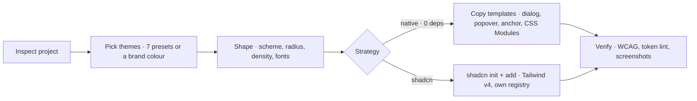
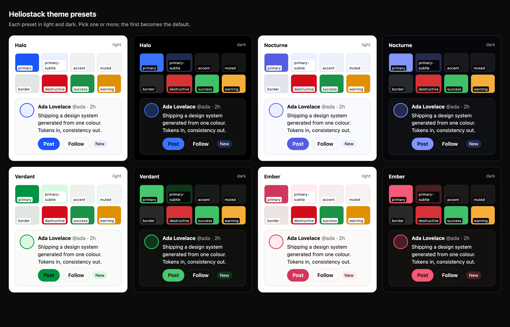
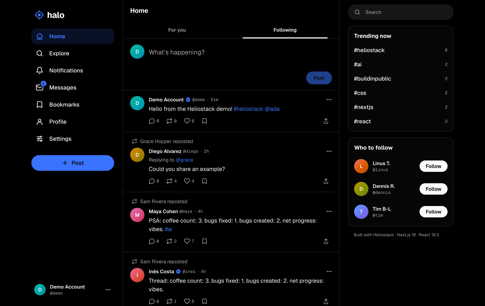

<div align="center">


# Heliostack

**Agent skills for building product-grade web apps on Next.js 16 + React 19.3 — with five runtime dependencies.**

[](https://nextjs.org)
[](https://react.dev)
[](https://www.typescriptlang.org)
[](https://github.com/porsager/postgres)
[](#the-stack)
[](LICENSE)

[Install](#install) · [Skills](#skills) · [Design system](#design-system-your-way) · [Reference app](#halo--the-proof) · [Lessons](#lessons-baked-in)

</div>

<br />

Heliostack is **one coherent set of decisions**, written as [Agent Skills](https://docs.claude.com/en/docs/claude-code/skills), so an AI agent can build an app the size of X or Spotify where every generated file fits every other one. Each skill is grounded in code that runs in **[Halo](https://github.com/heliostack-dev/halo)**, a realtime social network built with them — and corrected by what building it taught us.

## Why

> Libraries mostly save *typing*. An agent types for free.

What's left of a dependency, once an agent writes the code, is its cost: half-remembered version-specific APIs, transitive vulnerabilities, upgrade breakage. The platform is already installed, documented and stable — Web APIs, `node:*`, React 19.3, and Next.js 16, which even ships its docs inside `node_modules/next/dist/docs`.

So Heliostack leans on the platform and narrows every choice into a **closed vocabulary** — fixed tokens, a fixed component catalog, one folder layout, one action result shape — which is what makes generated code predictable and reviewable.

## The stack

| Concern | Heliostack | Instead of |
|---|---|---|
| Framework | Next.js 16.3 — Cache Components, Partial Prefetching, typed routes | pages router, custom servers |
| UI runtime | React 19.3 — Server Components, Actions, `useOptimistic`, `<ViewTransition>`, `<Activity>` | state & data-fetching libraries |
| Data | Postgres + [`postgres`](https://github.com/porsager/postgres) tagged SQL | ORMs, query builders |
| Validation | `zod` at every trust boundary | hand-rolled validators |
| Auth | scrypt + HMAC session tokens, `proxy.ts` | auth SaaS SDKs |
| Realtime | Server-Sent Events + Postgres `LISTEN/NOTIFY` | websocket services |
| UI | **your choice**: native (0 deps) or shadcn/ui — via `ds-init` | mixing both |
| Tests | `node:test` + real Postgres in WASM (PGlite) | jest, vitest, Docker |

```
runtime dependencies  →  next · react · react-dom · postgres · zod
```

## Install

**Claude Code**

```bash
/plugin marketplace add heliostack-dev/skills
/plugin install heliostack@heliostack
```

Then just describe what you want — _"start a new Heliostack app"_, _"set up the design system"_, _"build DMs"_ — and the matching skill loads.

**Other agents** — point them at [`AGENTS.md`](AGENTS.md), which indexes every `SKILL.md`.

## Skills

<table>
<tr><th>Start</th><th>Build UI</th><th>Build data &amp; logic</th><th>Ship</th></tr>
<tr valign="top">
<td>

[`heliostack`](skills/heliostack/SKILL.md)<br/><sub>entry point, rules, routing</sub>

[`feature-slice`](skills/feature-slice/SKILL.md)<br/><sub>end-to-end workflow, parallel agents</sub>

[`app-architecture`](skills/app-architecture/SKILL.md)<br/><sub>layout, boundaries, bootstrap</sub>

</td>
<td>

[`ds-init`](skills/ds-init/SKILL.md)<br/><sub>themes → shape → native or shadcn</sub>

[`ds-component`](skills/ds-component/SKILL.md)<br/><sub>contract, token lint, quality bar</sub>

[`native-ui-primitives`](skills/native-ui-primitives/SKILL.md)<br/><sub>dialog, popover, anchor, transitions</sub>

[`feeds-and-lists`](skills/feeds-and-lists/SKILL.md)<br/><sub>infinite lists without libraries</sub>

</td>
<td>

[`data-layer`](skills/data-layer/SKILL.md)<br/><sub>SQL, migrations, pagination, search</sub>

[`auth`](skills/auth/SKILL.md)<br/><sub>sessions, authorization, proxy</sub>

[`server-actions`](skills/server-actions/SKILL.md)<br/><sub>mutations, optimistic UI</sub>

[`caching`](skills/caching/SKILL.md)<br/><sub>static shells, `use cache`, tags</sub>

[`realtime`](skills/realtime/SKILL.md)<br/><sub>SSE + LISTEN/NOTIFY</sub>

</td>
<td>

[`testing`](skills/testing/SKILL.md)<br/><sub>node:test + PGlite, visual checks</sub>

[`deploy-vercel`](skills/deploy-vercel/SKILL.md)<br/><sub>Vercel + Neon, env, previews</sub>

</td>
</tr>
</table>

## Design system, your way

`ds-init` asks, previews, and generates — you make the choices.



<p align="center"></p>

- **Parametric OKLCH themes** — a preset is a neutral hue plus a primary colour; every semantic token is derived and **contrast-checked**.
- **One brand colour → a full theme**: `node theme.mjs from-color '#1d9bf0' --id brand`.
- **Same token contract for both strategies** (shadcn-compatible names), so switching later is a regeneration, not a redesign.
- **A token linter** keeps component CSS inside the vocabulary — raw colours, spacing and type values fail the check.

## Halo — the proof

<a href="https://heliostack-halo.vercel.app"></a>

Timelines, threads, reposts and quotes, follows, grouped notifications, DMs, search and trends, 7 themes, public by default — every page partially prerendered. Built with these skills by a lead agent plus three parallel feature agents. **[Live demo →](https://heliostack-halo.vercel.app)** &nbsp;·&nbsp; **[Source →](https://github.com/heliostack-dev/halo)**

## Lessons baked in

Things that actually broke while building Halo, now encoded as rules:

| What went wrong | Rule now |
|---|---|
| Buttons lost all styles — a component CSS chunk loaded before `base.css`, so `@layer components` was declared *first* and ranked lowest | Every CSS file starts with `@layer reset, tokens, base, components, utilities;` (linted) |
| A button stretched full width on mobile — two CSS Modules set `width` on one element in undefined order | Override another module's class via a parent-scoped selector |
| Timeline pages repeated items — `order by id` after `select id::text` sorted strings | Alias before casting |
| Compose dialog focused "Close" instead of the textarea | `<dialog>` + `data-autofocus` (React's `autoFocus` isn't an HTML attribute) |
| Dynamic routes warned about URL data | Client hooks like `usePathname` live inside `<Suspense>` |
| Realtime never fired locally | PGlite is single-session → an in-memory bus driver for dev |
| Route types went stale | `incremental: false` — TypeScript 7 is fast enough |
| The first UI "looked AI-made" | Measure a reference product, encode the numbers as tokens, verify with screenshots |

## Repository layout

```
.claude-plugin/        plugin + marketplace manifests
skills/<name>/SKILL.md one skill per folder, with references/, scripts/, themes/, templates/
scripts/               maintainer tools (sync templates from Halo)
AGENTS.md              index for agents without native skill loading
```

`scripts/sync-templates.sh` refreshes the native component templates and theme engine from Halo, where they are exercised by a real product.

## License

[MIT](LICENSE)
